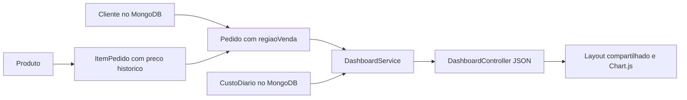

# Dashboard administrativo do Pediu Patrão

## Objetivo e escopo

O painel acompanha vendas e pedidos com dados fornecidos por uma API Spring Boot integrada ao MongoDB. A solução mantém Java 21, Spring Security, Thymeleaf e a arquitetura do projeto anterior. O painel usa o mesmo layout e Bootstrap das demais páginas. Os gráficos usam Chart.js 2.9.4, servido localmente.

O painel fica em `/dashboard`. O serviço de pedidos não foi substituído. A nova API está em `/api/dashboard` e tem acesso restrito a ADMIN e GERENTE. O ATENDENTE mantém suas responsabilidades anteriores e não acessa indicadores administrativos.

## Requisitos funcionais

| ID | Requisito | Critério de aceitação |
| --- | --- | --- |
| RF01 | Indicadores gerais de vendas | Exibir faturamento líquido, ticket médio, pedidos no período, finalizados, cancelados e clientes atendidos a partir da API |
| RF02 | Análise de vendas | Gráficos por dia ou mês, horário e região. Exibir dias e horas sem vendas com zero e oferecer tabelas alternativas |
| RF03 | Situação dos pedidos | Exibir quantidade por estado, incluindo cancelados. Estados legados aparecem em categoria própria |
| RF04 | Produtos mais vendidos | Ranking dos dez produtos com mais unidades em pedidos finalizados, identificados pelo ID do produto e com valor bruto histórico |
| RF05 | Filtros de consulta | Filtrar período, faixa de horário, região, cliente, situação e agrupamento diário ou mensal. Os componentes devem usar o mesmo recorte |
| RF06 | Integração com API | Buscar opções e indicadores via HTTP. Endpoints consultam os repositórios MongoDB e devolvem JSON. Não usar valores fixos na tela |
| RF07 | Atualização e tratamento | Consulta manual e atualização automática a cada 60 segundos, estados de carregamento, vazio, falha, tempo limite e indicação de dados desatualizados |
| RF08 | Vendas por cliente | Ranking por faturamento, número de pedidos e ticket médio por cliente. Selecionar um cliente permite analisar sua evolução diária ou mensal |
| RF09 | Custos operacionais diários | Registrar o total de custos de cada dia, inclusive zero confirmado. Identificar quem atualizou e quando. Mostrar cobertura dos dias e resultado operacional somente com custos completos e consulta geral |
| RF10 | Preservação histórica | Novos pedidos guardam cidade/bairro como região da venda. Pedidos antigos usam o cadastro atual com aviso explícito |

## Requisitos não funcionais

| ID | Requisito | Implementação ou limite |
| --- | --- | --- |
| RNF01 | Segurança | Sessão autenticada, autorização em rotas e serviço, CSRF na escrita de custos. Nenhuma credencial na resposta |
| RNF02 | Precisão | Cálculos monetários em BigDecimal no servidor. Arredondamento HALF_UP com duas casas decimais |
| RNF03 | Temporalidade | Instantes UTC e consultas no fuso America/Sao_Paulo. Datas ISO e fim do período exclusivo no banco |
| RNF04 | Usabilidade | Layout responsivo, labels de formulários, mensagens claras, nomes legíveis para estados e alternativas tabulares para gráficos |
| RNF05 | Desempenho | Índice em entrada, consulta limitada a até 366 dias e sem consulta de cliente para cada pedido. Agregações em memória adequadas à atividade, com necessidade futura de pipeline MongoDB em maior escala |
| RNF06 | Confiabilidade | Dados antigos incompletos geram avisos. Não inventar custos ou resultado. Erro de atualização não deve apresentar dados antigos como atuais |
| RNF07 | Manutenção | Controller HTTP, DTOs de resposta, serviço de análise e repositórios separados. Testes automatizados para regras e contratos |
| RNF08 | Reprodutibilidade | Maven Wrapper, scripts de execução e documentação no repositório. Chart.js local e layout compartilhado com as dependências do sistema |
| RNF09 | Privacidade | Ranking usa somente identificação e nome do cliente. Telefone, logradouro e credenciais não são expostos no dashboard |

## Decisões de análise e projeto

### Faturamento e ticket médio

- Faturamento é a soma do total dos pedidos FINALIZADOS no recorte. O total já contém descontos autorizados.
- Pedidos recebidos, em preparação, prontos ou em entrega não são receita concluída. Cancelados não entram no faturamento ou nos rankings.
- Ticket médio é faturamento dividido pelo número de pedidos finalizados com total válido. Sem vendas, retorna R$ 0,00.
- Pedidos no período e a situação operacional consideram todos os estados que atendem aos filtros.
- O filtro de situação se aplica a toda a consulta. Se selecionar CANCELADO, o faturamento fica zero e os cancelados continuam aparecendo na situação.
- Descontos são somados apenas para as vendas finalizadas no recorte.

### Datas, horários e histórico

- O período usa a data/hora de entrada do pedido, pois o projeto anterior não possui horário de finalização.
- Um pedido finalizado posteriormente atualiza a receita do período em que foi registrado. O painel não é um fechamento contábil imutável.
- `inicio` e `fim` são datas inclusivas no fuso de São Paulo. A consulta MongoDB usa `[inicio 00:00, dia seguinte ao fim 00:00)` convertido para UTC.
- A faixa horária inclui horaInicio e exclui horaFim. `22:00` até `02:00` aceita entradas das 22h às 23h59 e de 00h às 01h59 nos dias selecionados.
- As duas horas devem ser informadas juntas. Horas iguais são recusadas, evitando ambiguidade. Para o dia inteiro, deixe ambas vazias.
- Na ausência de datas, o período padrão tem 30 dias, incluindo hoje. O máximo aceito são 366 dias inclusivos.
- Novos pedidos guardam `regiaoVenda` com cidade/bairro. Isso evita que a alteração de endereço reescreva o histórico. Pedidos antigos usam o cadastro atual e geram aviso.
- Pedidos sem entrada não participam do filtro temporal e sua quantidade é informada como aviso.

### Produtos e clientes

- Produtos são agrupados pelo ID, contando unidades dos itens. O nome e preço vêm dos itens históricos dos pedidos.
- O valor bruto por produto não distribui o desconto geral do pedido. Ele é explicitamente rotulado como bruto para evitar confusão com o faturamento líquido.
- Os rankings mostram no máximo dez linhas. Empates são resolvidos pelo ID para garantir ordenação estável.
- Clientes são agrupados pelo ID, mesmo que tenham nomes iguais. A região não usa localização do IP ou dados externos.

### Custos

O sistema anterior não tinha despesas. Foi criada a coleção `custos_diarios`, com um documento por data ISO, valor, observação, versão e identificação da atualização. O mesmo dia é atualizado, não somado novamente. O controle otimista evita sobrescrita em operações simultâneas.

Cada dia precisa de um valor explícito, inclusive R$ 0,00 quando não houve custo. Sem todos os dias informados, o painel mostra somente os custos conhecidos e não calcula resultado operacional. Não é feita estimativa de custos a partir das vendas.

Custos são gerais do estabelecimento. Não são rateados entre clientes, regiões, estados ou horas. Com esses filtros ativos, o resultado operacional fica indisponível. Quando disponível, é faturamento menos os custos informados, sem equivaler a lucro contábil.

### Atualização

A tela consome um endpoint consolidado para que indicadores e gráficos sejam calculados no mesmo conjunto de pedidos. O MongoDB pode receber alterações entre leituras de pedidos, clientes e custos, portanto a resposta não representa um snapshot transacional contábil.

A atualização automática usa os últimos filtros aplicados, pausa com aba oculta e evita requisições sobrepostas. Uma nova consulta cancela a anterior. O tempo limite da consulta é 20 segundos. Em erro, as seções permanecem visíveis. Antes da primeira resposta válida, os indicadores mostram Não disponível. Se já havia uma resposta válida, os dados anteriores ficam esmaecidos e recebem aviso explícito de desatualização.

## Modelo de dados



- `Pedido.regiaoVenda`: novo campo opcional. Pedidos anteriores continuam legíveis.
- `Pedido.entrada`: índice crescente para recortar consultas no banco.
- As consultas de período usam um único intervalo BSON por campo, com `$gte` e `$lt` para pedidos e `$gte` e `$lte` para datas dos custos. O teste `DashboardMongoQueryTest` verifica a montagem pelo Spring Data.
- `CustoDiario.id`: data `AAAA-MM-DD`, chave única natural do lançamento diário.
- `CustoDiario.versao`: controle otimista do Spring Data.
- `DashboardResumo`: DTO consolidado, sem entidade Cliente completa nem credenciais.

## Documentação dos endpoints

### GET /dashboard

Retorna a página HTML, restrita a ADMIN e GERENTE. A página busca seus dados pela API. O HTML inclui token CSRF para o formulário de custos.

### GET /api/dashboard

Retorna indicadores, gráficos, rankings, custos e avisos.

| Parâmetro | Tipo | Padrão / regra |
| --- | --- | --- |
| inicio | data ISO | Hoje menos 29 dias |
| fim | data ISO | Hoje |
| horaInicio | HH:mm | Opcional, exige horaFim |
| horaFim | HH:mm | Opcional, exclusivo, permite faixa noturna |
| regiao | texto | Correspondência exata com opção devolvida em regioesDisponiveis |
| clienteId | texto | ID do cliente, opcional |
| status | enum | Um estado do fluxo existente, opcional |
| agrupamento | DIA ou MES | DIA |

Exemplo de requisição autenticada no navegador:

```javascript
api('/api/dashboard?inicio=2026-11-05&fim=2026-11-05&agrupamento=DIA')
```

Exemplo ilustrativo de resposta, para uma venda finalizada de R$ 90,00 e custo diário de R$ 30,00:

```json
{
  "filtros": {"inicio":"2026-11-05","fim":"2026-11-05","horaInicio":null,"horaFim":null,"regiao":null,"clienteId":null,"status":null,"agrupamento":"DIA"},
  "atualizadoEm":"2026-11-05T15:00:00Z",
  "fuso":"America/Sao_Paulo",
  "indicadores":{"faturamento":90.00,"pedidosFinalizados":1,"ticketMedio":90.00,"totalPedidos":1,"cancelados":0,"descontos":10.00,"clientesAtendidos":1},
  "vendasPeriodo":[{"rotulo":"2026-11-05","pedidos":1,"faturamento":90.00}],
  "vendasHorario":[{"rotulo":"00:00","pedidos":0,"faturamento":0.00}],
  "vendasRegiao":[{"rotulo":"Mogi / Centro","pedidos":1,"faturamento":90.00}],
  "situacaoPedidos":[{"status":"FINALIZADO","quantidade":1}],
  "produtos":[{"produtoId":"pizza","nome":"Pizza","quantidade":2,"valorBruto":100.00}],
  "clientes":[{"clienteId":"c1","nome":"Bruno","pedidos":1,"faturamento":90.00,"ticketMedio":90.00}],
  "custos":{"totalInformado":30.00,"diasInformados":1,"diasPeriodo":1,"completo":true,"resultadoDisponivel":true,"resultadoOperacional":60.00,"dias":[{"data":"2026-11-05","valor":30.00,"observacao":"Ingredientes","atualizadoPor":"gerente","atualizadoEm":"2026-11-05T15:00:00Z"}]},
  "regioesDisponiveis":["Mogi / Centro"],
  "avisos":[]
}
```

As listas vendasHorario e situacaoPedidos foram abreviadas no exemplo. A API real retorna 24 faixas horárias e todos os sete estados, incluindo quantidades zero, além de LEGADO quando necessário. A série temporal também preenche períodos sem vendas com zero. Custos sem cobertura ou com filtros segmentados retornam resultadoOperacional null.

### GET /api/dashboard/opcoes

Retorna os clientes disponíveis e os estados aceitos. ADMIN e GERENTE podem consultar opções sem receber os dados cadastrais completos.

```javascript
api('/api/dashboard/opcoes')
```

```json
{
  "clientes":[{"id":"c1","nome":"Bruno"}],
  "status":["RECEBIDO","EM_PREPARACAO","PRONTO","SAIU_PARA_ENTREGA","RETIRADO","FINALIZADO","CANCELADO"]
}
```

As regiões disponíveis são devolvidas na consulta principal e correspondem aos pedidos do período, antes dos filtros adicionais.

### PUT /api/dashboard/custos/{data}

Cria ou substitui o custo total da data. Exige ADMIN ou GERENTE e token CSRF válido. A data usa `AAAA-MM-DD`, entre os anos 2000 e 2100. O valor deve ser de zero até 999999999.99, com até duas casas decimais. A observação é opcional e limitada a 500 caracteres.

```javascript
api('/api/dashboard/custos/2026-11-05', 'PUT', {
  valor: 120.50,
  observacao: 'Ingredientes, energia e entregas'
})
```

```json
{
  "id":"2026-11-05",
  "versao":0,
  "valor":120.50,
  "observacao":"Ingredientes, energia e entregas",
  "atualizadoPor":"gerente",
  "atualizadoEm":"2026-11-05T15:00:00Z"
}
```

A identificação do responsável e o horário são obtidos no servidor. Consultar custos do período pela propriedade `custos.dias` do endpoint consolidado.

### Erros

| Código | Situação | Comportamento |
| --- | --- | --- |
| 302 | Sessão ausente | Spring Security redireciona para login. O dashboard identifica o redirecionamento como sessão expirada |
| 400 | Datas, horas, estado, agrupamento ou custo inválido | JSON com message explicando o erro. Formato inválido recebe mensagem de parâmetros |
| 403 | ATENDENTE ou CSRF ausente/inválido | Operação bloqueada pelo Spring Security |
| 409 | Conflito de versão no custo | Atualizar os dados antes de repetir |
| 503 | Falha de acesso ao MongoDB | Mensagem genérica, sem detalhes internos ou credenciais |

Exemplo:

```json
{"message":"Informe os dois horarios ou deixe ambos vazios"}
```

## Branches e GitFlow

- `main`: versão estável da atividade anterior.
- `develop`: base de integração da evolução M2.
- `feature/dashboard-administrativo`: implementação da API e do painel.

Fluxo: feature -> PR para develop -> validação da demonstração -> integração da entrega na main. O código não deve ser entregue apontando para uma branch sem avisar qual versão o professor deve consultar.

## Evidências e execução dos testes

Execute com JDK 21:

```powershell
.\mvnw.cmd test
.\mvnw.cmd package
node --check src/main/resources/static/js/dashboard.js
```

O Node é necessário apenas para a checagem opcional de sintaxe JavaScript, não para executar o sistema Java.

A evidência resumida está em [evidencias/testes-dashboard.txt](evidencias/testes-dashboard.txt). A suíte tem 60 testes. DashboardServiceTest verifica cálculos e filtros. DashboardApiTest executa controller, DTO, serviço real e filtros de segurança com repositórios simulados. DashboardMongoQueryTest verifica os intervalos BSON montados pelos repositórios. DataInitializerTest cobre o primeiro acesso seguro. Os testes anteriores de pedidos, auditoria, permissões e telas permanecem na suíte.

Os testes automatizados não exigem Atlas. O responsável confirmou o carregamento do dashboard com seu banco em 05/11/2026 após a correção das consultas. Essa confirmação manual é registrada separadamente em [evidencias/validacao-manual.md](evidencias/validacao-manual.md), sem atribuir aos testes simulados uma validação de persistência real. A resposta JSON de exemplo usa dados de teste, não extraídos do banco do responsável.

## Roteiro de apresentação de até três minutos

| Tempo | Mostrar e justificar |
| --- | --- |
| 0:00 a 0:25 | Entrar como ADMIN ou GERENTE, abrir dashboard e explicar que os dados vêm da API |
| 0:25 a 1:05 | Indicadores, situação e filtros de período/horário. Explicar que faturamento usa finalizados e ticket é valor por pedido |
| 1:05 a 1:40 | Gráficos por dia/mês, horário, região e rankings. Filtrar um cliente e mostrar a evolução |
| 1:40 a 2:10 | Custo de um dia, cobertura e resultado operacional. Explicar por que custo ausente não equivale a zero |
| 2:10 a 2:40 | Aba Rede mostrando GET /api/dashboard, parâmetros e resposta. Mostrar filtro inválido ou bloqueio de ATENDENTE |
| 2:40 a 3:00 | Documento de requisitos, testes e branch feature no GitHub. Explicar preservação de histórico e concluir |

Gravar a execução real com dados do projeto. O vídeo final deve ser disponibilizado no GitHub por link no README ou outro formato aceito pelo professor. Este documento não substitui a gravação individual.

## Segurança das contas

A inicializacao deixou de criar usuarios com senhas padronizadas no codigo. O primeiro ADMIN de um banco novo exige BOOTSTRAP_ADMIN_USERNAME e BOOTSTRAP_ADMIN_PASSWORD, sem valores padrao. O iniciador Windows pode receber esses valores por entrada oculta com -CriarAdministrador. A senha nao e salva em arquivo e e persistida no banco apenas como hash BCrypt.

Quando ja existe ADMIN, o bootstrap nao altera contas. Credenciais de GERENTE e ATENDENTE sao definidas pelo administrador na tela Usuarios. Um login existente nao pode ser promovido pelo bootstrap. As senhas antigas do banco devem ser trocadas pela interface, pois remover senhas do codigo nao modifica os hashes armazenados.

O teste DataInitializerTest cobre nove cenarios desta correcao. A suíte completa tem 60 testes aprovados. As instrucoes de primeiro acesso estao no README.
